<p align="center">
  <picture>
    <source media="(prefers-color-scheme: dark)" srcset=".github/banner-dark.svg">
    
  </picture>
</p>

# File Fusion

[](https://ybelov27.github.io/FileFusion/)
[](https://github.com/ybelov27/FileFusion/actions/workflows/pages.yml)
[](https://github.com/ybelov27/FileFusion/stargazers)
[](https://github.com/ybelov27/FileFusion/commits)
[](LICENSE)
[](https://github.com/ybelov27/FileFusion)


<p align="center">
  <a href="https://ybelov27.github.io/FileFusion/"><b>Try it now</b></a> ·
  <a href="https://github.com/ybelov27/FileFusion/issues/new?template=format-request.yml">Request a format</a> ·
  <a href="CONTRIBUTING.md">Contribute</a>
</p>

> If File Fusion saved you a trip to an upload-everything converter, please **star the repo**. It's the main way other people find it.

## Popular converters

[Image → PDF](https://ybelov27.github.io/FileFusion/image-to-pdf.html) · [PNG → JPG](https://ybelov27.github.io/FileFusion/png-to-jpg.html) · [JPG → PNG](https://ybelov27.github.io/FileFusion/jpg-to-png.html) · [WEBP → PNG](https://ybelov27.github.io/FileFusion/webp-to-png.html) · [WEBP → JPG](https://ybelov27.github.io/FileFusion/webp-to-jpg.html) · [JPG → WEBP](https://ybelov27.github.io/FileFusion/jpg-to-webp.html) · [PNG → WEBP](https://ybelov27.github.io/FileFusion/png-to-webp.html) · [SVG → PNG](https://ybelov27.github.io/FileFusion/svg-to-png.html) · [PNG → ICO](https://ybelov27.github.io/FileFusion/png-to-ico.html) · [Image → Base64](https://ybelov27.github.io/FileFusion/image-to-base64.html) · [MP3 → WAV](https://ybelov27.github.io/FileFusion/mp3-to-wav.html) · [M4A → WAV](https://ybelov27.github.io/FileFusion/m4a-to-wav.html) · [CSV → JSON](https://ybelov27.github.io/FileFusion/csv-to-json.html) · [JSON → CSV](https://ybelov27.github.io/FileFusion/json-to-csv.html) · [CSV → SQL](https://ybelov27.github.io/FileFusion/csv-to-sql.html) · [CSV → Markdown](https://ybelov27.github.io/FileFusion/csv-to-markdown.html) · [JSON → YAML](https://ybelov27.github.io/FileFusion/json-to-yaml.html) · [XML → JSON](https://ybelov27.github.io/FileFusion/xml-to-json.html) · [JSON → XML](https://ybelov27.github.io/FileFusion/json-to-xml.html) · [Markdown → HTML](https://ybelov27.github.io/FileFusion/markdown-to-html.html) · [HTML → Markdown](https://ybelov27.github.io/FileFusion/html-to-markdown.html) · [Markdown → PDF](https://ybelov27.github.io/FileFusion/markdown-to-pdf.html) · [Text → PDF](https://ybelov27.github.io/FileFusion/text-to-pdf.html) · [HTML → Text](https://ybelov27.github.io/FileFusion/html-to-text.html)

File Fusion is a static web app (TypeScript, built with Vite): a landing page and a converter that runs entirely in the browser (images to PNG/JPG/WEBP/PDF/BMP/ICO/Base64, audio to WAV, CSV/TSV/JSON/JSON Lines/XML to JSON/CSV/TSV/JSON Lines/Markdown/HTML/YAML/XML/SQL, and Markdown/HTML/text to HTML/Markdown/text/PDF). It is deployed to GitHub Pages at https://ybelov27.github.io/FileFusion/.

## Web App

File Fusion is written in TypeScript (`ui/src/`) and built with [Vite](https://vite.dev). You need Node.js 22.18 or newer.

1. Install dependencies:

   ```bash
   npm install
   ```

2. Start the dev server (live reload, generates the converter pages first):

   ```bash
   npm run dev
   ```

3. Open `http://localhost:8000/` (landing page) or `http://localhost:8000/app.html` (converter).

Other commands:

| Command             | What it does                                                                 |
| ------------------- | ---------------------------------------------------------------------------- |
| `npm run build`     | Generates the converter pages, type-checks, and builds the site into `dist/` |
| `npm run preview`   | Serves the built `dist/` at `http://localhost:8000`                          |
| `npm run typecheck` | Type-checks the app (`ui/src`) and the build scripts (`tools/`)              |
| `npm run format`    | Formats everything with Prettier                                             |

Pushes to `master` are built and deployed to GitHub Pages automatically.

### Google sign-in

Sign-in uses Google Identity Services and is optional; it stays hidden until a client ID is configured.

1. In the [Google Cloud console](https://console.cloud.google.com/apis/credentials), create an OAuth client ID of type **Web application**.
2. Under **Authorized JavaScript origins**, add `https://ybelov27.github.io` and `http://localhost:8000`.
3. Paste the client ID into `ui/src/config.ts` as `googleClientId`.

## License

File Fusion is released under the [MIT License](LICENSE).
